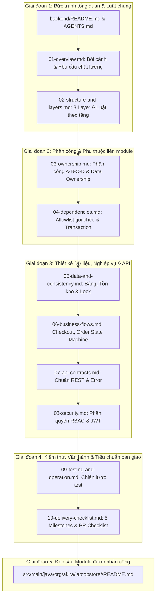

# LaptopStore — Hệ thống Bán Laptop Trực Tuyến (Backend Monolith)

Dự án Backend cho đồ án Web bán laptop B2C nhóm 4 người, xây dựng trên nền tảng **Java 25** và **Spring Boot 4.1.1**, cơ sở dữ liệu **PostgreSQL 17**. 
Hệ thống được thiết kế theo kiến trúc phân tầng hướng nghiệp vụ (**Feature-first 3-layer Monolith**), phân định ranh giới module rõ ràng, quản lý nhất quán dữ liệu và cơ chế giao tiếp liên module thông qua Service Contracts.

---

## Mục lục

1. [Tổng quan công nghệ & Cấu trúc dự án](#1-tổng-quan-công-nghệ--cấu-trúc-dự-án)
2. [Hướng dẫn chạy dự án (Quickstart Guide)](#2-hướng-dẫn-chạy-dự-án-quickstart-guide)
   - [Yêu cầu tiên quyết](#21-yêu-cầu-tiên-quyết)
   - [Cách 1: Chạy bằng Docker Compose (Khuyên dùng)](#22-cách-1-chạy-bằng-docker-compose-khuyên-dùng)
   - [Cách 2: Chạy cục bộ bằng Maven Wrapper](#23-cách-2-chạy-cục-bộ-bằng-maven-wrapper)
   - [Lưu ý quan trọng về hiện trạng Source Code](#24-lưu-ý-quan-trọng-về-hiện-trạng-source-code)
3. [Lộ trình đọc tài liệu kiến trúc trước khi code (Bắt buộc theo thứ tự)](#3-lộ-trình-đọc-tài-liệu-kiến-trúc-trước-khi-code-bắt-buộc-theo-thứ-tự)
   - [Giai đoạn 1: Bức tranh tổng quan & Quy tắc chung](#giai-đoạn-1-bức-tranh-tổng-quan--quy-tắc-chung-bắt-buộc-100-thành-viên)
   - [Giai đoạn 2: Phân công trách nhiệm & Ranh giới giao tiếp](#giai-đoạn-2-phân-công-trách-nhiệm--ranh-giới-giao-tiếp-ownership--dependency)
   - [Giai đoạn 3: Thiết kế Dữ liệu, Nghiệp vụ & API chi tiết](#giai-đoạn-3-thiết-kế-dữ-liệu-nghiệp-vụ--api-chi-tiết)
   - [Giai đoạn 4: Kiểm thử, Vận hành & Tiêu chuẩn bàn giao](#giai-đoạn-4-kiểm-thử-vận-hành--tiêu-chuẩn-bàn-giao)
   - [Giai đoạn 5: Đọc README của Module & Tầng được phân công](#giai-đoạn-5-đọc-readmemd-của-module--tầng-được-phân-công)
4. [Tài liệu trọng tâm theo phân công 4 vị trí (Owner A - B - C - D)](#4-tài-liệu-trọng-tâm-theo-phân-công-4-vị-trí-owner-a---b---c---d)
5. [Quy tắc vàng khi lập trình (Golden Rules)](#5-quy-tắc-vàng-khi-lập-trình-golden-rules)

---

## 1. Tổng quan công nghệ & Cấu trúc dự án

- **Ngôn ngữ & Framework:** Java 25, Spring Boot 4.1.1 (Spring Data JPA, Spring Web MVC, Flyway).
- **Cơ sở dữ liệu:** PostgreSQL 17 (`postgres:17-alpine`).
- **Containerization:** Dockerfile (Eclipse Temurin 25) & Docker Compose.
- **Base Package:** `org.akira.laptopstore`
- **Tổ chức thư mục:**

```text
LaptopStore/
├── backend/                             # Mã nguồn và tài liệu backend
│   ├── src/main/java/org/akira/laptopstore/
│   │   ├── auth/                        # Xác thực, JWT token rotation
│   │   ├── user/                        # Người dùng, địa chỉ, profile
│   │   ├── catalog/                     # Sản phẩm, biến thể (variant), danh mục, nhãn hiệu
│   │   ├── cart/                        # Giỏ hàng và mục trong giỏ
│   │   ├── order/                       # Đơn hàng, checkout coordinator, lịch sử trạng thái
│   │   ├── payment/                     # Thanh toán (COD, mô phỏng VNPay/cổng online)
│   │   ├── promotion/                   # Mã giảm giá (Coupon), lượt sử dụng
│   │   ├── inventory/                   # Biến động kho (Stock movements, ledger)
│   │   ├── procurement/                 # Nhập hàng từ nhà cung cấp (Purchase order)
│   │   ├── review/                      # Đánh giá sản phẩm sau khi mua
│   │   ├── security/                    # Cấu hình Spring Security, JWT Filter
│   │   ├── exception/                   # Xử lý ngoại lệ tập trung (GlobalExceptionHandler)
│   │   ├── config/                      # Cấu hình Bean hệ thống
│   │   └── common/                      # DTO chung (PageResponse,...), hằng số dùng chung
│   ├── src/main/resources/
│   │   ├── application.properties       # Cấu hình datasource & JPA
│   │   └── db/migration/                # Script Flyway migration SQL
│   ├── docs/
│   │   ├── architecture/                # 10 tài liệu kiến trúc chuẩn hóa
│   │   ├── phan_chia_cong_viec.md       # Bảng phân chia công việc nhóm
│   │   └── README.md                    # Mục lục tài liệu backend
│   ├── docker-compose.yml               # File compose cấu hình app & postgres
│   ├── .env.example                     # Template biến môi trường
│   └── pom.xml                          # Maven dependencies & build plugins
└── README.md                            # Tài liệu tổng quan repo (file này)
```

---

## 2. Hướng dẫn chạy dự án (Quickstart Guide)

### 2.1. Yêu cầu tiên quyết

- Đã cài đặt **Docker Desktop** (khuyên dùng, bao gồm cả Docker Engine và Docker Compose).
- Hoặc nếu chạy không qua Docker (Local Maven):
  - **JDK 25** (Eclipse Temurin 25 hoặc OpenJDK 25). Kiểm tra bằng: `java -version`.
  - **PostgreSQL 17** đang chạy cục bộ (port `5432`).

---

### 2.2. Cách 1: Chạy bằng Docker Compose (Khuyên dùng)

Cách này tự động dựng cả môi trường PostgreSQL 17 và đóng gói ứng dụng Spring Boot trên nền Temurin 25 mà không phụ thuộc vào JDK máy chủ.

#### Bước 1: Mở terminal và chuyển vào thư mục `backend`
```powershell
# Windows PowerShell
cd backend
```

#### Bước 2: Tạo file `.env` từ `.env.example`
```powershell
# Windows PowerShell:
Copy-Item .env.example .env

# Command Prompt (cmd):
copy .env.example .env

# Linux / macOS:
cp .env.example .env
```

#### Bước 3: Cấu hình biến môi trường
Mở file `.env` vừa tạo và điền mật khẩu cơ sở dữ liệu (bắt buộc):
```properties
APP_PORT=8080
SPRING_PROFILES_ACTIVE=dev
DB_HOST_PORT=5432
DB_NAME=laptop_store
DB_USERNAME=postgres
DB_PASSWORD=your_secure_password_here   # <-- Điền mật khẩu mong muốn
```

#### Bước 4: Khởi động hệ thống
```bash
docker compose up -d --build
```

#### Bước 5: Kiểm tra trạng thái và logs
```bash
# Xem trạng thái các container (app & postgres)
docker compose ps

# Xem log ứng dụng
docker compose logs -f app

# Xem log database
docker compose logs -f postgres
```

#### Bước 6: Dừng ứng dụng
```bash
# Dừng container nhưng giữ nguyên dữ liệu database
docker compose down

# CẢNH BÁO: KHÔNG dùng 'docker compose down -v' vì sẽ xóa sạch volume dữ liệu DB!
```

---

### 2.3. Cách 2: Chạy cục bộ bằng Maven Wrapper

Dành cho quá trình phát triển tính năng, viết test và debug trực tiếp trên IDE.

#### Bước 1: Khởi động cơ sở dữ liệu PostgreSQL 17
Bạn có thể tận dụng Docker Compose để chỉ chạy riêng container PostgreSQL:
```powershell
cd backend
docker compose up -d postgres
```
Hoặc đảm bảo PostgreSQL cục bộ của bạn đang chạy ở cổng `5432` với database `laptop_store`.

#### Bước 2: Cấu hình biến môi trường cho tiến trình
Ứng dụng sử dụng cấu hình từ [application.properties](backend/src/main/resources/application.properties):
- `DB_HOST`: mặc định `localhost`
- `DB_PORT`: mặc định `5432`
- `DB_NAME`: mặc định `laptop_store`
- `DB_USERNAME`: mặc định `postgres`
- `DB_PASSWORD`: mật khẩu DB của bạn

> **Lưu ý:** Spring Boot chạy trực tiếp từ dòng lệnh hoặc IDE không tự đọc file `.env` của Compose. Bạn cần thiết lập các biến này trong Run Configuration của IntelliJ IDEA/VS Code hoặc terminal:
> ```powershell
> # Windows PowerShell
> $env:DB_PASSWORD="your_secure_password_here"
> ```

#### Bước 3: Chạy ứng dụng hoặc kiểm thử
Từ thư mục `backend/`:
```powershell
# Chạy ứng dụng (Windows):
.\mvnw.cmd spring-boot:run

# Chạy ứng dụng (Linux/macOS):
./mvnw spring-boot:run

# Chạy toàn bộ test:
.\mvnw.cmd test
```

---

### 2.4. Lưu ý quan trọng về hiện trạng Source Code

> [!IMPORTANT]
> - **Cơ sở dữ liệu:** Cấu hình `spring.jpa.hibernate.ddl-auto=validate`. Khi chạy `mvnw test` hoặc khởi động app, Spring Boot kết nối tới PostgreSQL và yêu cầu schema hợp lệ (thông qua Flyway migration sẽ được nhóm bổ sung ở Milestone 0/1).
> - **Không tự ý hạ phiên bản:** Không tự ý hạ Java 25 xuống Java 21 hay Spring Boot 4.1.1 xuống 3.x nếu chưa có quyết định được cả nhóm thống nhất.

---

## 3. Lộ trình đọc tài liệu kiến trúc trước khi code (Bắt buộc theo thứ tự)

Toàn bộ hệ thống tài liệu chuẩn hóa nằm trong thư mục [backend/docs/architecture/](backend/docs/architecture/). Trước khi viết bất kỳ dòng code nào, **tất cả thành viên bắt buộc phải đọc tài liệu theo đúng 5 giai đoạn sau**:



---

### Giai đoạn 1: Bức tranh tổng quan & Quy tắc chung (Bắt buộc 100% thành viên)

1. [backend/README.md](backend/README.md) & [backend/AGENTS.md](backend/AGENTS.md):
   - **Mục đích:** Nắm rõ hiện trạng source code, phiên bản Java 25/Spring Boot 4.1.1, cấu trúc thư mục, quy tắc bảo toàn tính nguyên vẹn của tài liệu và các điều cấm kỵ cốt lõi.
2. [01-overview.md](backend/docs/architecture/01-overview.md) — **Tổng quan kiến trúc:**
   - **Mục đích:** Hiểu phạm vi dự án (B2C monolith), các luồng MVP (Catalog → Giỏ → Checkout COD → Giao hàng), ranh giới với frontend React, và các tiêu chuẩn chất lượng bắt buộc (chống bán vượt tồn - oversell, bảo toàn snapshot lịch sử đơn hàng, phân quyền RBAC).
3. [02-structure-and-layers.md](backend/docs/architecture/02-structure-and-layers.md) — **Cấu trúc thư mục và quy tắc các tầng:**
   - **Mục đích:** Hiểu rõ mô hình 3 tầng (Controller → Service → Repository). Nắm chắc quy tắc: Controller tuyệt đối không gọi Repository; Service điều phối transaction và trả DTO; Entity không được serialize ra API hoặc truyền xuyên qua module khác.

---

### Giai đoạn 2: Phân công trách nhiệm & Ranh giới giao tiếp (Ownership & Dependency)

4. [03-ownership.md](backend/docs/architecture/03-ownership.md) — **Ownership và phối hợp nhóm:**
   - **Mục đích:** Nắm rõ vai trò phân công cho 4 người (Owner A, B, C, D); quy định độc quyền ghi dữ liệu (Data Ownership) của từng module (ai sở hữu bảng nào, module khác chỉ được đọc/ghi thông qua Service Contract). Xem chi tiết tại [phan_chia_cong_viec.md](backend/docs/phan_chia_cong_viec.md).
5. [04-dependencies.md](backend/docs/architecture/04-dependencies.md) — **Phụ thuộc và hợp đồng giữa các module:**
   - **Mục đích:** Bảng Allowlist chiều phụ thuộc được phép (ví dụ: `order` được gọi `catalog`, `inventory`, `cart`, `promotion`, `user`; tuyệt đối cấm `cart → order`, `order → payment`, `catalog → inventory`). Nắm vững nguyên tắc Transaction boundary xuyên module (cùng tham gia 1 transaction `REQUIRED`, không mở `REQUIRES_NEW` tùy tiện).

---

### Giai đoạn 3: Thiết kế Dữ liệu, Nghiệp vụ & API chi tiết

6. [05-data-and-consistency.md](backend/docs/architecture/05-data-and-consistency.md) — **Dữ liệu và tính nhất quán:**
   - **Mục đích:** Quy ước kiểu dữ liệu (tiền dùng `BigDecimal`, thời gian dùng `Instant` UTC), cơ chế quản lý tồn kho khả dụng (`product_variants.quantity`) kết hợp sổ cái biến động kho (`stock_movements`), thứ tự khóa bản ghi (Lock ordering) theo ID tăng dần để ngăn ngừa deadlock.
7. [06-business-flows.md](backend/docs/architecture/06-business-flows.md) — **Luồng nghiệp vụ và trạng thái:**
   - **Mục đích:** Nắm vững từng bước trong Luồng Checkout nguyên tử (Atomic checkout), kịch bản hoàn tồn/coupon khi hủy đơn, và cỗ máy trạng thái đơn hàng (Order State Machine: `PENDING` → `CONFIRMED` → `PACKING` → `SHIPPING` → `DELIVERED` / `CANCELLED`).
8. [07-api-contracts.md](backend/docs/architecture/07-api-contracts.md) — **Quy ước API và lỗi:**
   - **Mục đích:** Chuẩn hóa REST API prefix `/api/v1`, định dạng phân trang `PageResponse<T>`, mã lỗi chuẩn RFC 7807/thống nhất, và header chống trùng lặp `Idempotency-Key` khi tạo đơn hàng.
9. [08-security.md](backend/docs/architecture/08-security.md) — **Bảo mật và quyền truy cập:**
   - **Mục đích:** Ma trận phân quyền 3 roles (`USER`, `STAFF`, `ADMIN`), kiểm tra Ownership khi truy cập tài nguyên cá nhân (`/me/**`), cơ chế bảo mật xác thực với access token Bearer và refresh token lưu trong HttpOnly Cookie, mã hóa mật khẩu qua `PasswordEncoder`.
10. [11-entity-model.md](backend/docs/architecture/11-entity-model.md) và [12-ERD-LaptopStore.md](backend/docs/architecture/12-ERD-LaptopStore.md) — **Entity và ERD chuẩn:**
    - **Mục đích:** Đọc đúng 25 thực thể, từng thuộc tính, PK/FK/UQ, tên field Java và 29 quan hệ trước khi viết entity hoặc migration.

---

### Giai đoạn 4: Kiểm thử, Vận hành & Tiêu chuẩn bàn giao

11. [09-testing-and-operation.md](backend/docs/architecture/09-testing-and-operation.md) — **Kiểm thử và vận hành:**
    - **Mục đích:** Chiến lược test theo rủi ro (Unit test cho tính toán giá/coupon; WebMvc test cho phân quyền/validation; Integration test trên PostgreSQL thật cho concurrency, chống oversell và rollback).
12. [10-delivery-checklist.md](backend/docs/architecture/10-delivery-checklist.md) — **Kế hoạch triển khai và tiêu chí hoàn tất:**
    - **Mục đích:** 5 Milestones triển khai dự án (từ Milestone 0 chốt nền đến Milestone 4 demo). Bảng **Checklist 9 bước** bắt buộc phải tự kiểm tra trước khi tạo Pull Request bàn giao bất kỳ use case nào.

---

### Giai đoạn 5: Đọc README của Module được phân công

Sau khi đã nắm toàn bộ quy chuẩn chung, khi bắt tay vào triển khai một tính năng cụ thể, bạn cần đọc:
- File `README.md` tổng tại thư mục module: `backend/src/main/java/org/akira/laptopstore/<module_name>/README.md` (ví dụ: [order/README.md](backend/src/main/java/org/akira/laptopstore/order/README.md), [catalog/README.md](backend/src/main/java/org/akira/laptopstore/catalog/README.md), [cart/README.md](backend/src/main/java/org/akira/laptopstore/cart/README.md),...).
- Quy tắc cho các tầng con (`controller`, `service`, `repository`, `entity`, `dto`, `mapper`) được quy định tập trung tại [02-structure-and-layers.md](backend/docs/architecture/02-structure-and-layers.md).

---

## 4. Tài liệu trọng tâm theo phân công 4 vị trí (Owner A - B - C - D)

Để tối ưu hóa thời gian, sau khi đọc xong Giai đoạn 1 & 2, từng thành viên tập trung chuyên sâu vào các tài liệu tương ứng với phân công của mình (xem chi tiết tại [phan_chia_cong_viec.md](backend/docs/phan_chia_cong_viec.md)):

| Vai trò | Phụ trách Module | Tài liệu kiến trúc trọng tâm | Nhiệm vụ chính cần bàn giao |
|---|---|---|---|
| **Owner A** | `auth`, `user`, `security`, `config`, `exception`, `common` | [03-ownership](backend/docs/architecture/03-ownership.md), [04-dependencies](backend/docs/architecture/04-dependencies.md), [07-api-contracts](backend/docs/architecture/07-api-contracts.md), [08-security](backend/docs/architecture/08-security.md) | Hạ tầng đăng nhập JWT (access token Bearer, refresh token trong HttpOnly cookie), RBAC filter, chuẩn lỗi tập trung, API User/Address, điều phối tài liệu & base Flyway. |
| **Owner B** | `catalog`, `inventory`, `procurement` | [04-dependencies](backend/docs/architecture/04-dependencies.md), [05-data-and-consistency](backend/docs/architecture/05-data-and-consistency.md) | Quản lý sản phẩm/biến thể, Service contract kiểm tra và trừ tồn kho khả dụng, ghi sổ cái `stock_movements`, đơn nhập hàng. |
| **Owner C** | `cart`, `order` | [04-dependencies](backend/docs/architecture/04-dependencies.md), [05-data-and-consistency](backend/docs/architecture/05-data-and-consistency.md), [06-business-flows](backend/docs/architecture/06-business-flows.md) | Quản lý giỏ hàng, Điều phối luồng Checkout nguyên tử, hủy đơn hoàn tồn, cỗ máy trạng thái đơn hàng và Idempotency-Key. |
| **Owner D** | `payment`, `promotion`, `review` | [04-dependencies](backend/docs/architecture/04-dependencies.md), [06-business-flows](backend/docs/architecture/06-business-flows.md), [07-api-contracts](backend/docs/architecture/07-api-contracts.md) | Thanh toán COD, tạo session thanh toán online, quản lý mã Coupon và đánh giá sản phẩm sau khi đơn hàng đã giao (`DELIVERED`). |

---

## 5. Quy tắc vàng khi lập trình (Golden Rules)

1. **Không gọi Repository của Module khác:** Mọi giao tiếp giữa các module phải thông qua **Service Contract** (được định nghĩa trong Allowlist tại [04-dependencies.md](backend/docs/architecture/04-dependencies.md)).
2. **Không quan hệ JPA Cascade xuyên module:** Entity của module này tuyệt đối không dùng `@ManyToOne`, `@OneToMany` trực tiếp đến Entity module khác. Chỉ lưu ID kiểu `Long` và thiết lập khóa ngoại (FK) bằng Flyway migration SQL.
3. **Controller mỏng, Service giàu nghiệp vụ:** Controller chỉ nhận request, validate hình dạng dữ liệu, lấy thông tin `principal` và chuyển cho Service; Controller tuyệt đối không mở `@Transactional` hay inject Repository.
4. **Không trả Entity ra ngoài API:** Dữ liệu trả về cho Frontend phải qua `dto/response` và Mapper tương ứng.
5. **Tiền tệ & Thời gian:** Dữ liệu tiền VND luôn dùng `BigDecimal` (làm tròn `HALF_UP`), thời gian luôn dùng `Instant` (UTC).
6. **Bảo vệ tính nhất quán giao dịch:** Quá trình checkout (tạo đơn, trừ kho, dùng coupon, dọn giỏ hàng) phải nằm trọn vẹn trong một `@Transactional` duy nhất. Không gọi API HTTP của bên thứ ba (cổng thanh toán) khi đang mở transaction DB.
7. **Tuân thủ Checklist trước khi tạo PR:** Tự rà soát lại các mục trong [10-delivery-checklist.md](backend/docs/architecture/10-delivery-checklist.md) trước khi yêu cầu đồng đội review code.
