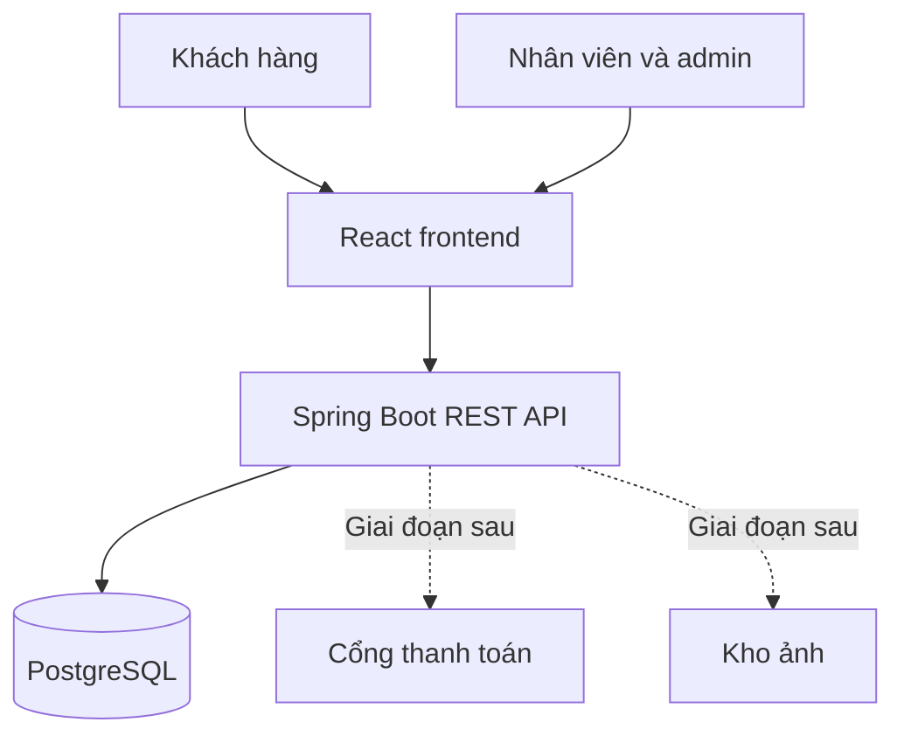

# Tổng quan kiến trúc

## Mục tiêu và phạm vi

LaptopStore là web bán laptop B2C cho đồ án nhóm bốn người: khách tìm sản phẩm, mua hàng; nhân viên xử lý đơn/nhập hàng; quản trị viên quản lý dữ liệu và tài khoản. Backend tổ chức theo nghiệp vụ, mỗi module giữ Controller → Service → Repository. Một tiến trình Spring Boot dùng chung một PostgreSQL; đây là monolith phân tầng theo feature, chưa có kiểm soát module tự động và không tuyên bố triển khai Clean/Hexagonal.

MVP đi xuyên suốt catalog → giỏ → đơn COD → xử lý giao hàng. Sau đó thêm procurement, coupon, review và thanh toán mô phỏng. VNPay thật, hoàn tiền, nhập hàng từng phần, nhiều kho, microservices, broker, AI và báo cáo tài chính phức tạp ngoài MVP.

## Bối cảnh hệ thống

React, cổng thanh toán và kho ảnh là thành phần dự kiến; hiện chưa có source frontend. Spring Boot xử lý quyền, giá, trạng thái và transaction; không giao các quyết định đó cho frontend.

## Hiện trạng xác minh từ source

| Hạng mục | Quan sát trong project | Việc còn thiếu |
|---|---|---|
| Java và Spring | `pom.xml`: Java 25, Spring Boot 4.1.1 | Kiểm tra dependency tương thích khi bổ sung; không tự hạ phiên bản |
| Base package | `org.akira.laptopstore` | Mọi module mới dưới package này |
| Bootstrap | `LaptopStoreApplication.java` | Chưa có controller/service/repository/entity nghiệp vụ |
| Data | JPA, PostgreSQL driver, Flyway; `ddl-auto=validate` | Chưa có migration SQL/schema nghiệp vụ |
| Docker | Temurin 25; Compose `app`, `postgres:17-alpine` | Healthcheck chỉ cho DB; không có health endpoint ứng dụng |
| Test | Một `@SpringBootTest contextLoads` | Chưa có bộ test nghiệp vụ/fixture/Testcontainers |
| Auth | Chưa có starter security/JWT và code auth | Cần triển khai trước API cá nhân/admin |
| API support | Web MVC đã khai báo | Bean Validation, OpenAPI chưa khai báo trực tiếp |
| Vận hành | `.env.example`, Dockerfile, Compose | Chưa có CI kiểm tra ranh giới/branch protection |
| Tài liệu | 11 tài liệu kiến trúc trong `docs/architecture/` | Nhóm thống nhất giải pháp trực tiếp qua 11 tài liệu kiến trúc |

Đợt rà soát 2026-09-21 cập nhật ownership tồn kho, entity model, migration guideline và bổ sung ArchUnit test kiến trúc; chưa tạo entity/migration nghiệp vụ thật.

## Mục tiêu chất lượng và cách chứng minh

| Mục tiêu | Kịch bản chấp nhận |
|---|---|
| Nhất quán tồn | Hai request mua SKU còn 1: một thành công, một 409, không âm |
| Phân quyền | USER không đọc đơn người khác, không tự cấp ADMIN |
| Lịch sử đúng | Sửa giá/địa chỉ gốc không thay snapshot đơn đã tạo |
| Dễ chia việc | Contract chéo có owner, DTO và mã lỗi; không import repo module khác |
| Khả năng chạy lại | Migration chạy được trên DB trống và nâng cấp DB dùng chung |
| Tránh truy vấn quá mức | Danh sách có phân trang, không fetch collection vô hạn; đo trên dữ liệu demo |
