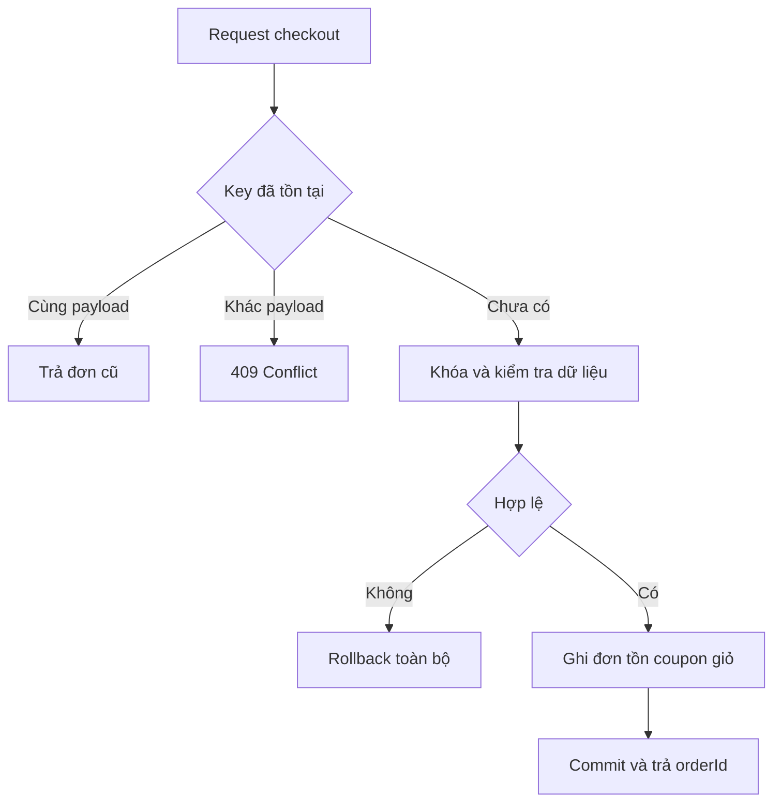

# Luồng nghiệp vụ và trạng thái

Các luồng là thiết kế đề xuất, cần được nhóm chốt và thống nhất trước khi triển khai. Quyền ở đây bổ sung kiểm tra role, không thay kiểm tra ownership.

## Checkout

1. USER gửi addressId, paymentMethod, couponCode tùy chọn, note và Idempotency-Key; actorId lấy từ principal.
2. Order kiểm tra key cũ trước; khóa cart và lấy items cần mua; từ chối giỏ trống.
3. User service kiểm tra địa chỉ thuộc khách; catalog trả variant/giá/trạng thái/version.
4. Khóa coupon nếu có, kiểm tra điều kiện bằng snapshot và tính subtotal, discount, shippingFee, total tại server; MVP shippingFee = 0 là lựa chọn đề xuất. Tổng không âm; không nhận tổng từ client.
5. Tạo Order PENDING để có orderId trong transaction. Inventory nhận lines kèm expectedVersion, khóa variants theo id tăng dần; catalog kiểm tra trạng thái bán/version và tồn. Snapshot đã thay đổi trả 409 PRODUCT_CHANGED và rollback, chưa chốt đơn cho khách.
6. Inventory giảm tồn và ghi SALE gắn orderId; hoàn tất items/snapshot/history; promotion ghi usage; cart xóa mục đã mua. Mọi việc trong cùng transaction; order tạo sớm cũng rollback nếu bước sau thất bại.
7. Commit rồi trả order. COD chờ xác nhận/giao; online mở payment session bằng request khác. Checkout lỗi ở bất kỳ bước nào rollback toàn bộ.

## Trạng thái order

| Từ | Đến | Ai và điều kiện | Tác động |
|---|---|---|---|
| PENDING | CONFIRMED | STAFF/ADMIN; online phải PAID | History; không trừ tồn thêm |
| PENDING | CANCELLED | Chủ đơn hoặc STAFF/ADMIN; online chưa PAID | Hoàn tồn/coupon một lần |
| CONFIRMED | PACKING | STAFF/ADMIN | History |
| CONFIRMED | CANCELLED | STAFF/ADMIN, chưa bàn giao; online chưa PAID | Hoàn tồn/coupon một lần |
| PACKING | SHIPPING | STAFF/ADMIN | Ghi thông tin bàn giao |
| SHIPPING | DELIVERED | STAFF/ADMIN xác nhận giao | Không đổi stock; COD thu tiền là bước payment riêng |
| SHIPPING | DELIVERY_FAILED | STAFF/ADMIN | Giữ tồn đã trừ |
| DELIVERY_FAILED | SHIPPING | STAFF/ADMIN giao lại | Không đổi stock |
| DELIVERY_FAILED | CANCELLED | STAFF/ADMIN; xác nhận hàng đã về kho và online chưa PAID | Hoàn tồn/coupon đúng một lần |

DELIVERED và CANCELLED là trạng thái cuối trong MVP. USER chỉ tự hủy PENDING; STAFF xử lý các trường hợp khác theo bảng. Đơn online đã PAID muốn hủy/hoàn phải có quy trình hoàn tiền bổ sung, không ép vào endpoint hủy hiện tại. Mỗi lần chuyển lưu from/to, actor, reason, timestamp.

## Hủy và payment callback đồng thời

Hủy khóa order, kiểm tra paymentStatus projection rồi chuyển CANCELLED và hoàn tồn/coupon. Callback khóa payment rồi order. Nếu callback PAID được xử lý trước, hủy online bị chặn. Nếu hủy commit trước, callback lưu tiền đã nhận với `RECONCILIATION_REQUIRED`; order vẫn CANCELLED. OrderPaymentService trả outcome này thay vì throw làm mất bản ghi tiền đã nhận.

## Thanh toán

Payment có trạng thái UNPAID/PENDING/PAID/FAILED; hoàn tiền đầy đủ/partial ngoài MVP. `Order.paymentStatus` là projection nhận từ payment. COD mới tạo order có UNPAID và chưa cần Payment; sau DELIVERED, STAFF/ADMIN gọi ghi nhận thu tiền, payment tạo bản ghi PAID và cập nhật order cùng transaction. DELIVERED đơn thuần chưa chứng minh đã thu tiền.

Online: payment kiểm tra order và số tiền → tạo attempt PENDING có idempotency key → commit → gọi provider/mô phỏng ngoài transaction → cập nhật session → callback xác minh → ghi kết quả và thông báo order service trong cùng transaction. Session timeout có thể có kết quả không rõ: tra cứu lại theo reference/idempotency trước tạo attempt khác, không tự coi FAILED khi chưa biết provider đã thu tiền hay chưa.

Callback FAILED lặp hoặc đến sau PAID không làm PAID lùi về FAILED. Order service chỉ áp dụng một kết quả thanh toán thành công cho mỗi order, dưới khóa order; payment attempt thứ hai thành công phải giữ record và đưa vào đối soát. Hai request ghi thu COD cạnh tranh cũng phải kiểm tra lại projection dưới khóa, không tạo hai khoản thu hợp lệ. Browser return page luôn đọc lại trạng thái backend.

## Nhập hàng

STAFF/ADMIN tạo phiếu DRAFT cho supplier và các variant. Khi nhận toàn bộ: khóa phiếu → xác minh DRAFT → inventory tăng stock/ghi PURCHASE_RECEIPT → chuyển RECEIVED → commit. Gọi receive lần nữa trả kết quả cũ mà không cộng tồn. DRAFT có thể CANCELLED; RECEIVED không chỉnh sửa trực tiếp. Một dòng lỗi rollback cả phiếu.

## Coupon và review

Coupon preview không giữ lượt. Checkout kiểm tra lại dưới khóa và reserve usage; hủy hợp lệ chuyển usage RELEASED một lần. Review chỉ tạo khi order item thuộc actor và đơn DELIVERED; unique order_item_id bảo vệ hai request đồng thời. Review không quyết định lại trạng thái đơn.
