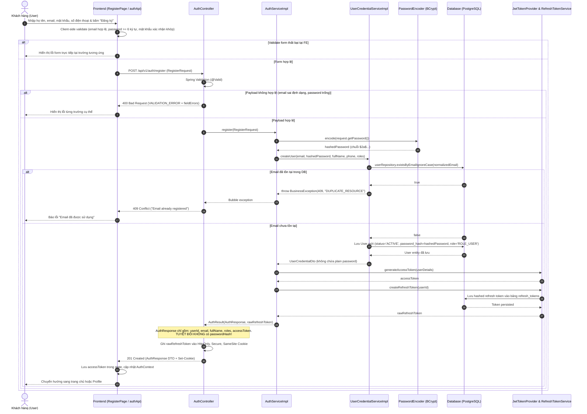

# SD-05: Sequence Diagram — Quy trình Đăng ký (Register)

> **Mã thiết kế:** SD-05  
> **Module:** `auth`, `user`, `security`  
> **Trạng thái:** Accepted (Đã được duyệt trước khi implement)  
> **Người thực hiện:** Huy  
> **Reviewer / Phê duyệt:** Khang

---

## 1. Biểu đồ tuần tự (Mermaid Sequence Diagram)

---

## 2. Các quy tắc bảo mật & chuẩn hóa

1. **Chuẩn hóa Email:** Email được `trim()` và chuyển thành chữ thường (`toLowerCase()`) trước khi kiểm tra trùng lặp và lưu trữ.
2. **Mã hóa mật khẩu:**
   - Mật khẩu thuần được băm qua `BCryptPasswordEncoder` ngay tại tầng Service trước khi chuyển sang `UserCredentialService`.
   - Chuỗi hash bắt đầu bằng `$2a$` hoặc `$2b$` với độ an toàn cao.
3. **Không rò rỉ dữ liệu nhạy cảm:**
   - `AuthResponse` DTO chỉ chứa: `userId`, `email`, `fullName`, `roles`, `accessToken`.
   - Không xuất hiện `password` hay `passwordHash` trong bất kỳ response, error body hay log application.
4. **Bảo vệ Refresh Token:**
   - Refresh token dạng raw chỉ truyền về client qua **HttpOnly Cookie** (`path=/api/v1/auth`, `SameSite=Lax/Strict`, `Secure` khi bật HTTPS).
   - Database chỉ lưu hash của refresh token (`token_hash`) để phòng chống rò rỉ database.
