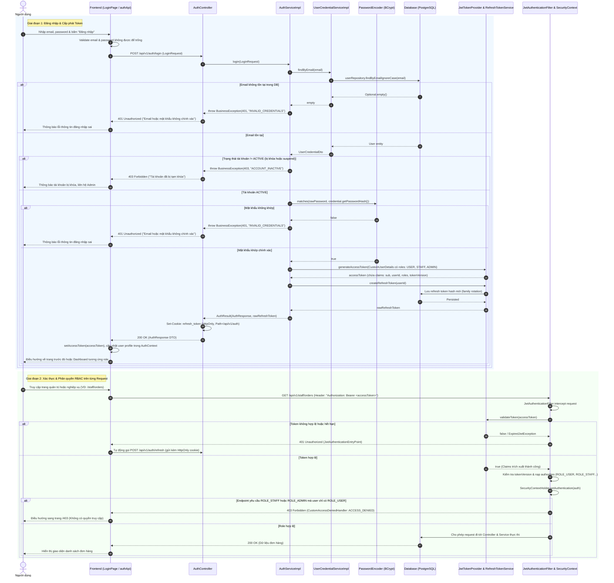

# SD-06: Sequence Diagram — Quy trình Đăng nhập (Login) + JWT/RBAC

> **Mã thiết kế:** SD-06  
> **Module:** `auth`, `user`, `security`  
> **Trạng thái:** Accepted (Đã được duyệt trước khi implement)  
> **Người thực hiện:** Huy  
> **Reviewer / Phê duyệt:** Khang

---

## 1. Biểu đồ tuần tự (Mermaid Sequence Diagram)

---

## 2. Nguyên tắc xác thực & RBAC

1. **Phòng chống Account Enumeration:** Cả hai trường hợp sai email hoặc sai mật khẩu đều trả về cùng mã lỗi `401 UNAUTHORIZED` với message chung "Invalid email or password" (`INVALID_CREDENTIALS`).
2. **Kiểm tra trạng thái tài khoản thời gian thực:** Kiểm tra `status == 'ACTIVE'` khi đăng nhập và đối chiếu `tokenVersion` khi lọc JWT để vô hiệu hóa ngay phiên làm việc khi tài khoản bị khóa.
3. **Phân quyền đa vai trò (Multi-Role):**
   - User có thể sở hữu đồng thời nhiều role: `ROLE_USER`, `ROLE_STAFF`, `ROLE_ADMIN`.
   - Các API `/staff/**` yêu cầu có `ROLE_STAFF` hoặc `ROLE_ADMIN`.
   - Các API `/admin/**` chỉ chấp nhận `ROLE_ADMIN`.
   - Quyền hạn được kiểm tra cả ở tầng Filter (`SecurityConfig`) và tầng Service qua `@PreAuthorize`.
