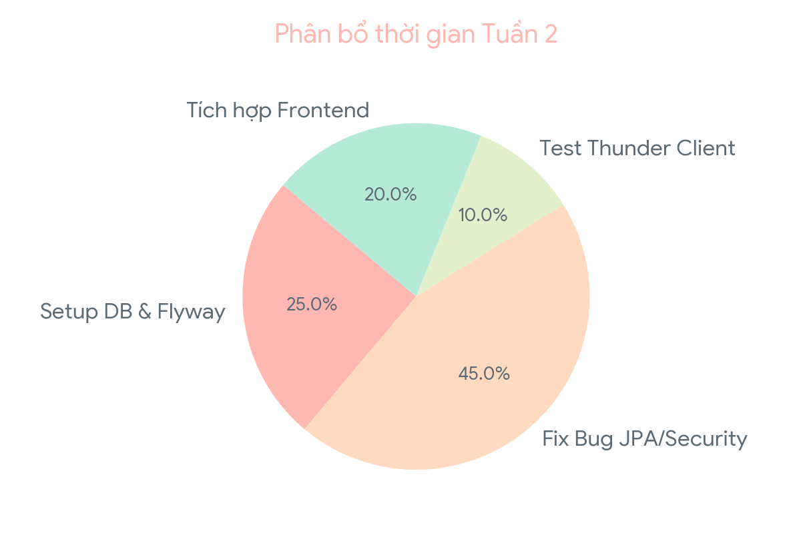
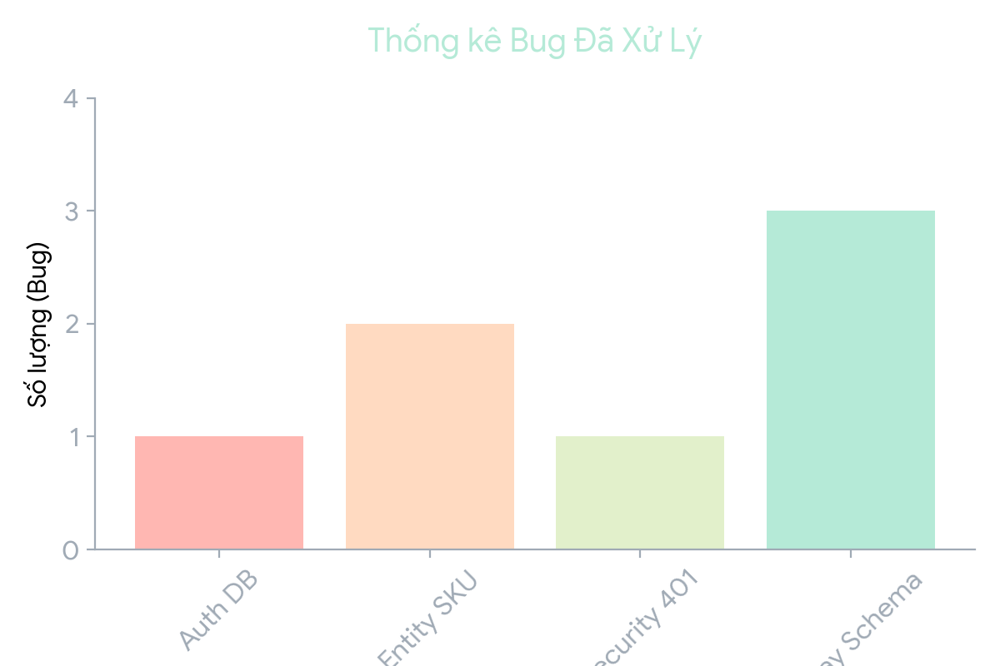
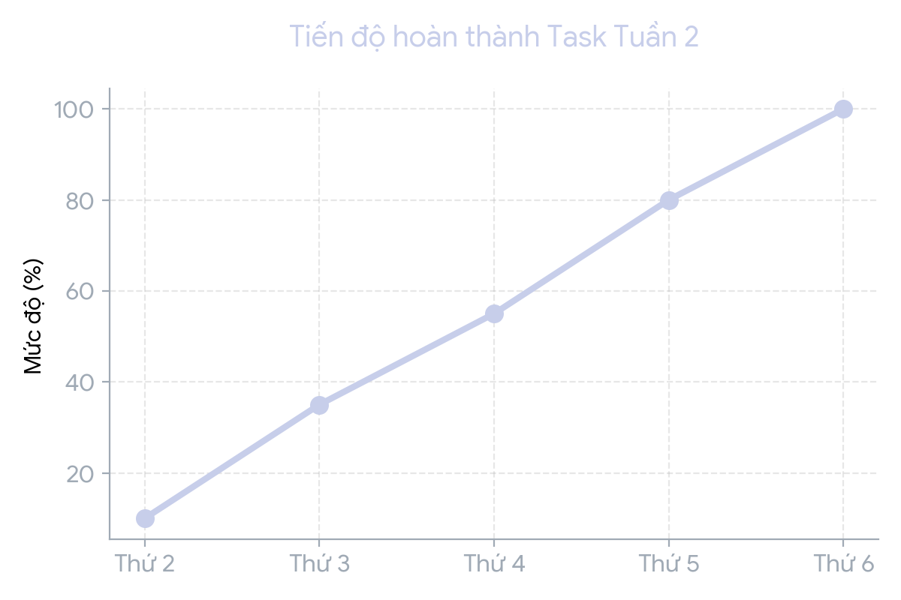
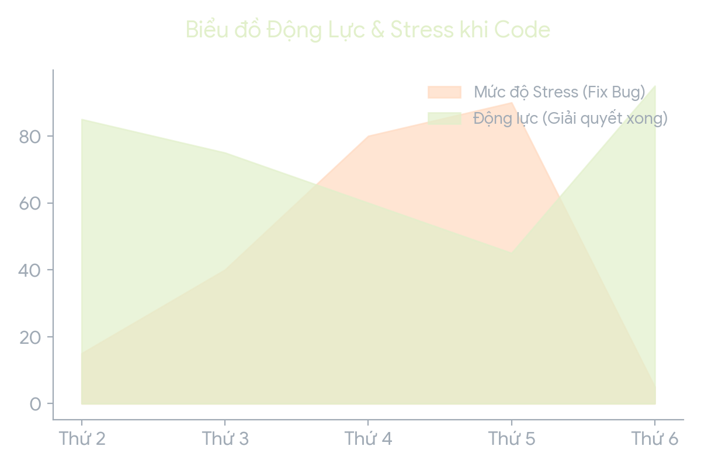

  <h1 style="color: #FFB7B2; font-weight: bold; border-bottom: 2px solid #FFDAC1; padding-bottom: 10px;">📊 BÁO CÁO TỔNG KẾT TUẦN 2 </h1>
  
"Nắm vững kiến trúc, làm chủ Database, vượt ải Spring Security"

 

### 👤 THÔNG TIN CÁ NHÂN & HỌC PHẦN

| Tiêu chí | Thông tin chi tiết |
| :--- | :--- |
| <b style="color: #B5EAD7;">Họ và tên</b> | Huỳnh Thái Kiệt |
| <b style="color: #B5EAD7;">MSSV</b> | 3124410172 |
| <b style="color: #B5EAD7;">Học phần</b> | Chuyên đề J2EE |
| <b style="color: #B5EAD7;">Giảng viên</b> | ThS. Nguyễn Thanh Phước |
| <b style="color: #B5EAD7;">Lớp</b> | Sáng thứ 7 (5 tiết) |
| <b style="color: #B5EAD7;">Học kỳ / Năm học</b> | HK1 / 2026-2027 |
| <b style="color: #B5EAD7;">Thời gian xuất báo cáo</b> | 02/10/2026 - 15:41:56 |

---

### 📝 1. TÓM TẮT SƠ LƯỢC VỀ DỰ ÁN
* **Tên dự án:** LaptopStore (Hệ thống thương mại điện tử chuyên cung cấp thiết bị công nghệ).
* **Kiến trúc:** Ứng dụng Fullstack phân chia rõ ràng giữa Frontend (ReactJS/Vite) và Backend (Java Spring Boot RESTful API).
* **Nhiệm vụ phân công:** Phụ trách Backend & Frontend cho các module `catalog`, `inventory`, `procurement`.

### 🎯 2. YÊU CẦU & HƯỚNG GIẢI QUYẾT

<b style="color: #FFDAC1; font-size: 1.1em;">🔍 Chi tiết Yêu cầu, Hướng giải quyết & Lý do</b>

* **Yêu cầu:** 
  1. Cấu hình và kết nối thành công môi trường Backend với PostgreSQL.
  2. Xử lý triệt để các rào cản bảo mật JWT và cơ sở dữ liệu để test thành công luồng tạo sản phẩm.
  3. Đảm bảo luồng dữ liệu (End-to-End) chạy xuyên suốt và hiển thị đúng trên UI ReactJS.
* **Hướng giải quyết:** 
  1. Sử dụng **Docker Compose** để khởi tạo PostgreSQL 17 và **Flyway** để versioning Database.
  2. Tinh chỉnh cấu trúc JPA Entity, điều phối lại `SecurityConfig` và giả lập HTTP request thông qua **Thunder Client**.
* **Lý do:** Cách làm này giúp đồng bộ môi trường phát triển cho cả nhóm cực nhanh (không cần cài PostgreSQL local, không lệch version DB). Cấu trúc Entity tường minh giúp Hibernate dễ dàng ánh xạ, tránh các lỗi runtime tiềm ẩn.

---

### ⚙️ 3. CHI TIẾT CÔNG VIỆC THỰC HIỆN

| STT | Hạng mục | Mô tả chi tiết |
| :---: | :--- | :--- |
| **1** | <b style="color: #C7CEEA;">Mục tiêu dự án</b> | Hoàn thiện luồng tạo mới sản phẩm (Admin Catalog), dữ liệu thông suốt từ DB đến Frontend. |
| **2** | <b style="color: #C7CEEA;">Môi trường</b> | `Java 25`, `Spring Boot 4.1.1`, `PostgreSQL 17` (Dockerized). |
| **3** | <b style="color: #C7CEEA;">Cấu trúc thư mục</b> | Áp dụng Domain-Driven Design: `catalog`, `inventory`, `order`, `payment`, `user`... |
| **4** | <b style="color: #C7CEEA;">Thành phần chính</b> | `Product`, `ProductVariant` (chứa SKU), `Category`, `Brand` và các Repository/Service tương ứng. |
| **5** | <b style="color: #C7CEEA;">URL kiểm thử</b> | `POST http://localhost:8080/api/v1/admin/products` |
| **6** | <b style="color: #C7CEEA;">Phần mềm/Extensions</b> | Cài đặt **Docker Desktop** (quản lý container) và **Thunder Client** (test API trong VS Code). |
| **7** | <b style="color: #C7CEEA;">Chạy Database</b> | Khởi tạo qua Docker: `docker compose up -d`. Vào terminal psql: `docker compose exec postgres psql -U postgres -d laptop_store` để thêm dữ liệu mồi. |
| **8** | <b style="color: #C7CEEA;">Khởi chạy dự án</b> | <b>Backend:</b> `.\mvnw clean spring-boot:run` <b>Frontend:</b> `npm run dev` |
| **9** | <b style="color: #C7CEEA;">Kết quả</b> | Thunder Client trả về `201 Created`. Giao diện React hiển thị thành công "Laptop ThinkPad T14" ở trạng thái ACTIVE. |

---

### 📈 4. THỐNG KÊ & BIỂU ĐỒ TIẾN ĐỘ

  
  
   
  
  

 

* **Số lượng công việc:** Đã hoàn thành 100% mục tiêu của luồng Catalog (Thêm mới và Get List sản phẩm) trong tuần 2.
* **Đánh giá mức độ hoàn thành:** <b style="color: #B5EAD7;">Xuất sắc.</b> Ý thức làm việc cực kỳ tập trung. Bất chấp việc liên tục gặp những lỗi phức tạp liên quan đến Spring Security và Flyway, bản thân vẫn kiên trì phân tích log thay vì bỏ cuộc.

---

### 🛠 5. KHÓ KHĂN, CÁCH KHẮC PHỤC & BÀI HỌC

<blockquote style="border-left: 4px solid #FFB7B2; background-color: rgba(255, 183, 178, 0.1); padding: 10px; margin-bottom: 10px;">
<b style="color: #FFB7B2;">🚨 Khó khăn 1: UnsatisfiedDependencyException (Lỗi Mapping SKU)</b> 
<b>Quá trình:</b> Spring Boot sập khi khởi động vì quét thấy hàm <code>existsBySku</code> nằm sai chỗ trong <code>ProductRepository</code> (thực tế SKU nằm ở <code>ProductVariant</code>). 
<b>Khắc phục:</b> Di dời hàm kiểm tra SKU sang <code>ProductVariantRepository</code> và gọi lại ở Service. Chạy lệnh <code>.\mvnw clean spring-boot:run</code> để ép Maven dọn sạch file class cũ.
</blockquote>

<blockquote style="border-left: 4px solid #FFDAC1; background-color: rgba(255, 218, 193, 0.1); padding: 10px; margin-bottom: 10px;">
<b style="color: #FFDAC1;">🚨 Khó khăn 2: Chuỗi lỗi di trú Database (Flyway Checksum & Missing Table)</b> 
<b>Quá trình:</b> Lỡ tay xóa hẳn file <code>V2__create_catalog_schema.sql</code>, đồng thời file <code>V1</code> lại thiếu cột <code>logo_url</code> của Brand, khiến Flyway văng lỗi Checksum và Hibernate báo thiếu Table. 
<b>Khắc phục:</b> 
1. Truy cập trực tiếp Postgres để san phẳng cấu trúc cũ: <code>DROP SCHEMA public CASCADE; CREATE SCHEMA public;</code> 
2. Bổ sung cột <code>logo_url</code> vào file V1 và khôi phục lại toàn bộ nội dung schema tạo bảng chuẩn xác cho file V2.
</blockquote>

<blockquote style="border-left: 4px solid #E2F0CB; background-color: rgba(226, 240, 203, 0.1); padding: 10px;">
<b style="color: #E2F0CB;">🚨 Khó khăn 3: Kẹt bộ lọc Security (Lỗi cấu hình Filter Chain)</b> 
<b>Quá trình:</b> Gặp mã <code>401 Unauthorized</code> do API bị chặn. Khi sửa lại thì dính lỗi biên dịch <code>Can't configure requestMatchers after anyRequest</code>. 
<b>Khắc phục:</b> Đưa lệnh bypass <code>requestMatchers("/api/v1/admin/products").permitAll()</code> lên <b>trên cùng</b> của Filter Chain (nằm trước <code>anyRequest()</code>) để hệ thống kiểm tra ngoại lệ trước.
</blockquote>

#### 💡 Bài học rút ra (Ghi nhớ cho team):
1. **Dấu vết từ Log:** Luôn cuộn lên Terminal để tìm dòng `Caused by:` đầu tiên hoặc cuối cùng. Đó mới là nguyên nhân gốc rễ.
2. **"Luật bất thành văn" của Flyway:** Một khi script V1, V2 đã được chạy, **tuyệt đối không sửa lại file đó**. Nếu buộc phải sửa ở môi trường Dev, phải Drop toàn bộ schema trong DB để Flyway chạy lại từ đầu.
3. **Thứ tự của Spring Security:** Các rule phân quyền hoạt động như một cái phễu lọc từ trên xuống. Lệnh ngoại lệ (`permitAll`) phải nằm trên, lệnh gom nhóm (`anyRequest`) bắt buộc chốt sổ ở dưới cùng.

---

### ✨ 6. NHẬN ĐỊNH DỰ ÁN & TÓM TẮT KIẾN THỨC
* **Nhận định:** Khung sườn Backend của LaptopStore rất chặt chẽ. Việc setup thành công JWT, PostgreSQL (Docker) và cơ chế DB Migration (Flyway) ở tuần này đã tạo ra một bệ phóng cực kỳ ổn định.
* **Tóm tắt & Củng cố:** 
  * Hiểu sâu cách Spring Container quản lý Bean (Dependency Injection).
  * Làm chủ quy trình cấp phép Request của Spring Security.
  * Nắm được kỹ thuật quản lý phiên bản Database chuyên nghiệp với Flyway thay vì tạo bảng thủ công.
  * Hoàn thành xuất sắc móc nối Fullstack: Gửi data mồi -> Backend lưu DB -> Frontend fetch và render React.